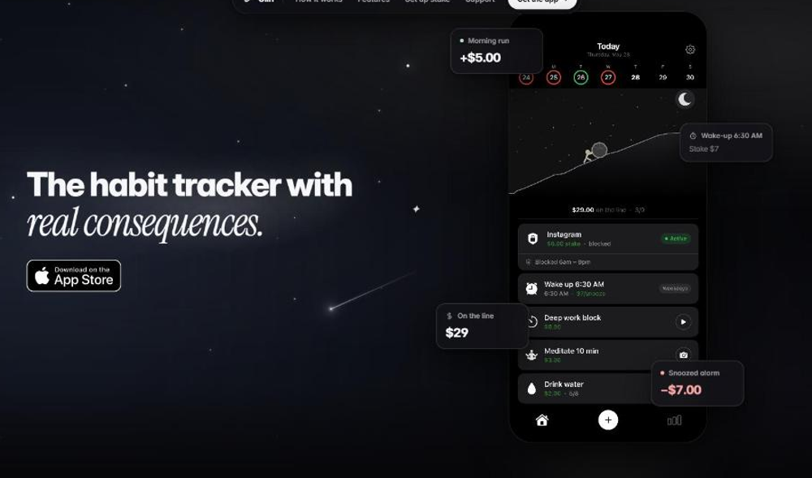
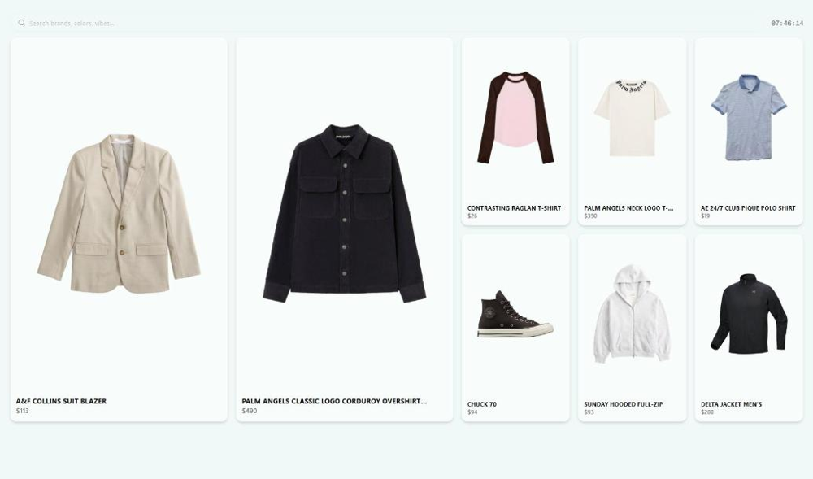

<picture>
  <source media="(prefers-color-scheme: dark)" srcset="./card-dark.svg">
  
</picture>

  <samp>
    <a href="https://www.vestko.com">Vestko</a> ·
    <a href="https://glinhq.com">Glin</a> ·
    <a href="https://www.linkedin.com/in/almas-ataman/">LinkedIn</a> ·
    <a href="mailto:almasataman.cs@gmail.com">almasataman.cs@gmail.com</a>
  </samp>

 

### What I'm building

<table>
<tr>
<td width="50%" valign="top">

<h4><a href="https://glinhq.com">Glin</a></h4>

A habit tracker where missing a goal costs real money. Live on the <a href="https://apps.apple.com/app/glin-great-lock-in/id6785099379">App Store</a>.

<ul>
<li>Blocks distracting apps through Apple's Screen Time APIs (FamilyControls, ManagedSettings)</li>
<li>Live Activity timer on the lock screen, and squads so friends can see each other's progress</li>
</ul>
Swift · TypeScript · Supabase · Stripe
</td>
<td width="50%" valign="top">

<h4><a href="https://www.vestko.com">Vestko</a></h4>

A digital wardrobe. Save clothes from any store and build outfits in one place.

<ul>
<li>Chrome extension that pulls product images from almost any retailer, with 6 fallback strategies</li>
<li>Image pipeline that removes backgrounds and normalizes garments across 7 categories</li>
</ul>
Next.js · Express · Prisma · PostgreSQL · AWS S3
</td>
</tr>
</table>

### How I like to build

- If it isn't deployed, it doesn't count
- Measure first, then optimize
- The boring parts (retries, idempotency, rollouts) are where software actually breaks, so I care about them most
